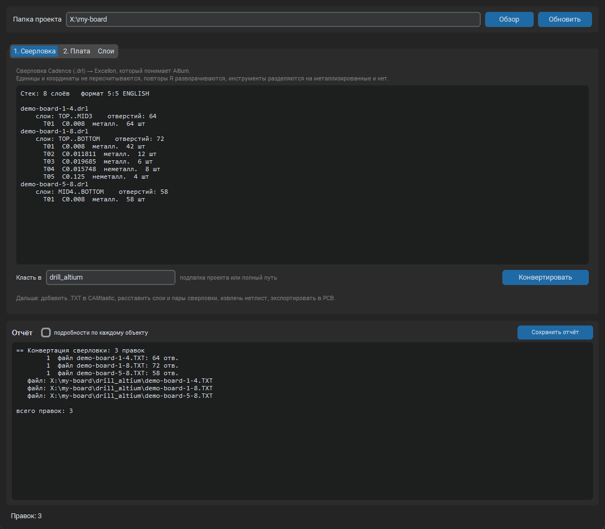
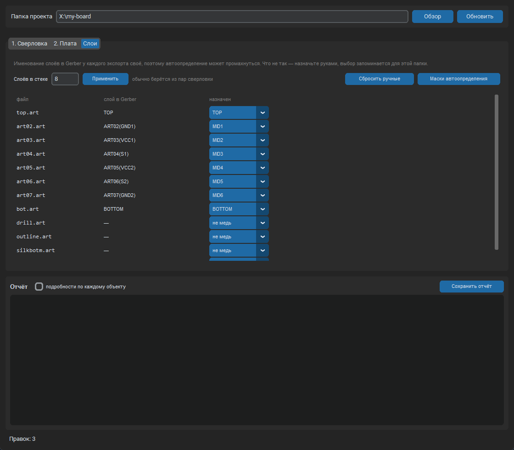

# gerberHelper

**Русский** · [English](README.en.md)

Помощник для переноса платы из Cadence Allegro в Altium. Пакет производства (Gerber и
сверловка) загружается в CAMtastic и экспортируется в PCB; утилита готовит данные до
импорта и чинит то, что CAMtastic испортил после. Эталон всегда сами производственные
данные: всё, что утилита правит, она берёт из Gerber и файлов сверловки.

<p align="center"></p>

## Какие проблемы решает

- **Сверловка Allegro (`.drl`) не импортируется в CAMtastic.** Утилита переписывает её в
  Excellon в формате Altium: единицы и координаты не пересчитываются, повторы `Rnn`
  разворачиваются в явные отверстия, инструменты делятся на металлизированные и нет.
  Понимает оба варианта выгрузки Allegro: с `M00` и с `Tnn` (`TOOL-SELECT YES`).
- **После экспорта в PCB у via не те слои.** У части глухих и скрытых via пара слоёв
  оказывается сквозной (TOP–BOTTOM). Утилита ставит `STARTLAYER` / `ENDLAYER` по парам
  слоёв из файлов сверловки.
- **Повёрнутые пады теряют форму.** Овалы и квадраты под 45° приходят прямоугольниками
  без поворота. Утилита восстанавливает `SHAPE`, `XSIZE`, `YSIZE`, `ROTATION` по
  апертурам Gerber, в том числе по макросам `%AM`.
- **Диаметры via по слоям.** Для Full Stack via размеры на каждом слое берутся из Gerber.
- **Пустые полигоны без сети** (`No Net`) удаляются вместе с перенумерацией ссылок.
- **Полигоны превратились в штриховку из треков.** Так бывает, когда Gerber сделан в CAM350 или
  похожей программе: заливка там лежит тысячами перекрывающихся штрихов, и в PCB приходят
  тысячи треков вместо полигонов. Утилита объединяет штрихи в контур и записывает его как
  `Polygon` той же цепи (см. ниже).
- **Пропали отверстия без контактных площадок** (крепёжные и другие отверстия, вокруг которых в
  Gerber нет меди: CAMtastic не из чего создать пад). Утилита сравнивает плату со сверловкой и
  добавляет недостающие.
- **Именование слоёв в Gerber у каждого экспорта своё.** Автоопределение по маскам из
  `layer_rules.json` плюс ручное назначение в окне.

## Порядок работы

1. Положить Gerber (`*.art`) и сверловку (`*.drl`, желательно с `nc_param.txt`) в одну папку.
2. Вкладка «1. Сверловка» → «Конвертировать».
3. В CAMtastic: импортировать Gerber и полученные `.TXT`, расставить слои и пары сверловки,
   извлечь нетлист, экспортировать в PCB.
4. В Altium: via, пришедшие падами, возвращаются в via массовым выделением, утилита этого
   не делает. Диаметры via обычно проще назначить одинаковыми вручную.
5. `File → Save As → PCB ASCII`, закрыть Altium, вкладка «2. Плата» → «Анализ» → выбрать
   нужные операции → «Применить».
6. Открыть результат в Altium.

Пары слоёв берутся из имён файлов сверловки вида `<имя>-<от>-<до>.drl`, как их называет
Allegro: `board-1-4.drl` — слои с 1-го по 4-й.

Утилита приводит плату к Gerber, поэтому ручные правки вносятся **после** её прогона.
Повторный прогон по уже доведённой руками плате вернёт эти места к тому, что нарисовано
в Gerber, и скажет об этом в отчёте.

## Установка и запуск

```bash
git clone https://github.com/Gimran/gerberHelper.git
cd gerberHelper
pip install customtkinter
```

`customtkinter` нужен только окну; ядро и командная строка работают на стандартной
библиотеке. Для операции «штриховка в полигоны» нужна ещё `shapely` (`pip install shapely`),
остальным она не требуется. Проверялось на Windows 11 и Python 3.14, на более старых версиях Python не
запускалось.

| Как запустить | Что это |
|---|---|
| `Allegro-Altium.pyw` | двойной клик из проводника: лаунчер `pyw.exe` работает без консоли и сам находит Python |
| `allegro2altium.bat` | запасной вариант: проверяет, что есть Python и `customtkinter`, и пишет, чего не хватает |
| `python gui.py` | то же окно из консоли |

## Окно

<p align="center"></p>

- **«1. Сверловка»**: найденные `.drl` с парами слоёв, инструментами и числом отверстий,
  кнопка «Конвертировать». Результат кладётся в подпапку проекта (по умолчанию
  `drill_altium`).
- **«2. Плата»**: выбор ASCII PcbDoc, операции галочками, «Анализ» и «Применить».
- **«Слои»**: раскладка Gerber по стеку. Автоопределение читает запись
  `G04 Layer: ETCH/<имя>`, а если её нет, имя файла. Что опознано неверно, назначается
  вручную выпадающим списком, выбор запоминается для папки. Маски лежат в
  `layer_rules.json` и правятся без правки кода (кнопка «Маски автоопределения»).
  Глубина стека берётся из пар сверловки, при необходимости задаётся руками.

## Операции над платой

| Операция | Что делает | По умолчанию |
|---|---|---|
| Растащить via по слоям | `STARTLAYER` / `ENDLAYER` по парам сверловки | вкл |
| Форма и поворот площадок | `SHAPE`, `XSIZE`, `YSIZE`, `ROTATION` по апертурам Gerber | вкл |
| Диаметры via по слоям | для Full Stack (`PADMODE=2`) послойные размеры; `DIAMETER` ставится равным максимуму, как это делает сам Altium | выкл |
| Штриховка треками в полигоны | объединяет перекрывающиеся штрихи одной цепи в контур, записывает `Polygon`, штрихи удаляет; значимые вырезы в заливке сохраняются разрезом; нужна `shapely` | выкл |
| Недостающие отверстия | для отверстий из сверловки, под которыми на плате нет ни пада, ни via, добавляет `Pad` без цепи размером с отверстие; металлизация берётся из файла сверловки, а отверстия от заданного диаметра (в окне поле «неметаллизир. от, мм», в CLI `--holes-npth-over`) делаются неметаллизированными; поясок меди задаёт `--holes-ring`; отверстия с неверным диаметром только перечисляются | выкл |
| Шелкография: вырезы и регионы | вложенные полигоны на `TOPOVERLAY`/`BOTTOMOVERLAY` (вырезы букв «О», «А»), которые CAMtastic закрашивает, становятся внутренними контурами `Region`; все полигоны шелкографии переписываются в регионы, потому что Region не пересчитывается при Repour и не тормозит (`--silk-keep-polygons`: только с вырезами, у остальных снимается «Remove Islands Less Than»); нужна `shapely` | выкл |
| Удалить полигоны без сети | polygon pour без сети на медных слоях; полигоны шелкографии не трогает | вкл |

Дополнительные галочки: обнулять размер via на слоях, где в Gerber нет площадки, и
удалять полигоны без сети на слоях шелкографии.

## Командная строка

```bash
python cli.py info --folder <папка>                    что найдено в папке
python cli.py run --all --folder <папка>               анализ, ничего не пишет
python cli.py run --all --folder <папка> --apply       с записью
python cli.py run drill --folder <папка> --out <куда>  только конвертация сверловки
```

Шаги: `drill`, `via_layers`, `pads`, `via_sizes`, `polygons`. Ключи `--pcb`,
`--zero-missing`, `--include-silk`, `-v` описаны в `python cli.py -h`. Ручное назначение
слоёв доступно только в окне.

## Как утилита обращается с файлом платы

- **Ничего не пишется без «Применить»** (в командной строке без `--apply`). Анализ
  считает всё и показывает отчёт.
- **Перед записью создаётся копия** `имя.PcbDoc.bakN`; номер растёт, старые копии не
  затираются.
- **Правятся только нужные поля.** Файл разбирается на записи и разделители строк,
  меняются значения внутри строк: порядок записей, концы строк и все остальные байты
  сохраняются.
- **Проверка целостности.** После операций сверяется число записей каждого типа, меняться
  может только то, что удаляется намеренно. При ошибке, например висячей ссылке на
  удалённый полигон, запись отменяется.
- **Повторный прогон по неизменённой плате даёт ноль правок.**

## Ограничения

- PcbDoc нужен текстовый: `File → Save As → PCB ASCII`. Двоичный файл утилита не читает.
- Altium с этим файлом на момент записи должен быть закрыт.
- Формат сверловки берётся из `nc_param.txt`, из заголовка `M48` или из `;FILE_FORMAT`;
  если ничего нет, принимается 2:5 дюймы.
- Площадки со сложной апертурой (`%AM` с примитивом 4, полигональный контур) не
  трогаются, они перечисляются в отчёте.
- Слои внутри пролёта via, где в Gerber площадки нет, по умолчанию остаются как есть.
  Галочка «обнулять» ставит туда 0, но как Altium отнесётся к нулевому пояску в DRC,
  нужно проверять.
- Via, стоящая не точно на своём отверстии, отмечается в отчёте.
- Утилита проверялась на двух восьмислойных платах из выгрузок Allegro 16.6. На других
  выгрузках могут понадобиться правки масок слоёв или кода.

## Тесты

```bash
python tests/regression.py
python tests/test_hatch.py
python tests/test_holes.py
python tests/test_silk.py
```

`regression.py` прогоняет утилиту на двух платах и побайтово сверяет результат с эталонами:
конвертация сверловки для обоих вариантов выгрузки Allegro и полный набор операций над
PcbDoc. `test_hatch.py` и `test_holes.py` проверяют штриховку и недостающие отверстия на
синтетических платах, реальные данные им не нужны.

Реальные платы, на которых это гоняется, в репозиторий не входят (`tests/fixtures/` в
`.gitignore`). Без них случаи из `tests/cases.json` помечаются как пропущенные, а не
проваленные. Чтобы проверять на своих данных, положите туда свои выгрузки по образцу из
`cases.json`: папка с `.drl` и `nc_param.txt` плюс папка `expected/` с ожидаемыми `.TXT`.

## Устройство

```
Allegro-Altium.pyw    запуск окна
allegro2altium.bat    запуск с диагностикой
gui.py                окно: три вкладки
cli.py                те же операции из командной строки
layer_rules.json      маски автоопределения слоёв
core/
  gerber.py           разбор RS-274X: апертуры, макросы %AM, флэши
  excellon.py         чтение сверловки Allegro, запись в формате Altium
  pcbdoc.py           ASCII PcbDoc: правка полей без сдвига остальных байтов
  hatch.py            штриховка треками в полигоны (shapely)
  silk.py             вырезы в полигонах шелкографии (shapely)
  layers.py           применение масок автоопределения
  project.py          что лежит в папке, стек, раскладка слоёв
  ops.py              операции над сверловкой и платой
  runner.py           порядок операций, проверка целостности, запись
tests/                регрессия с эталонами
```

`settings.json` (последняя папка, галочки, ручные назначения слоёв) создаётся при первом
запуске и в репозиторий не попадает.

## Лицензия

[MIT](LICENSE)
